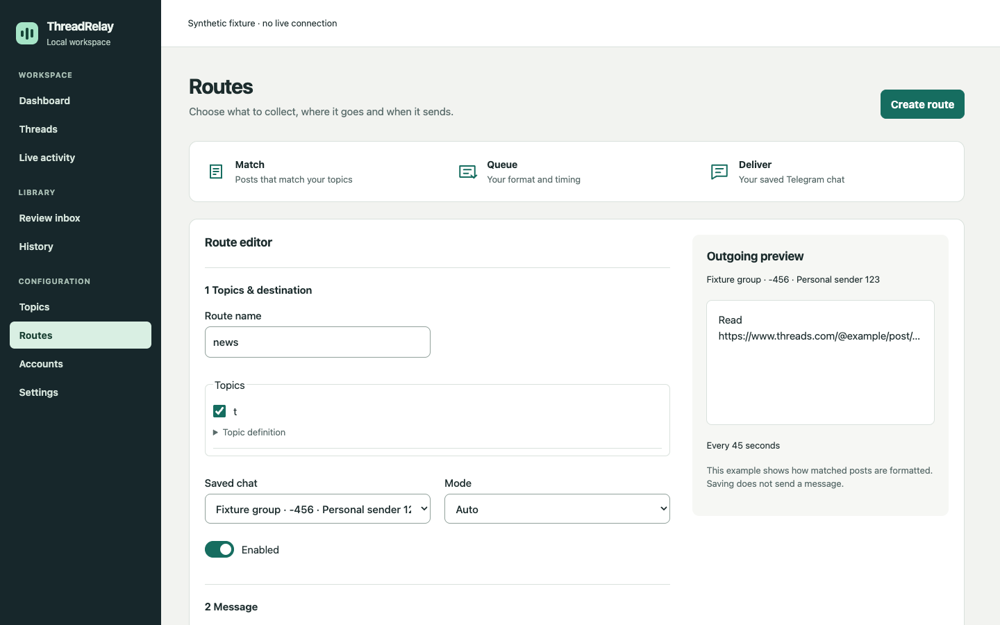

<div align="center">


# ThreadRelay

**Your Threads feed. Your topics. Your Telegram.**

A local-first desktop workspace for finding relevant Threads posts,
keeping a permanent record, and delivering selected links through your Telegram account.


[](https://tauri.app/)
[](https://react.dev/)
[](https://www.python.org/)

[Get started](#get-started) · [How it works](#how-it-works) · [Development](#development) · [Privacy](#privacy-and-recovery)

</div>



<sup>Interface preview using synthetic demonstration data. No live account or messages are shown.</sup>

## Made for a clear workflow

| | What you can do |
| --- | --- |
| **Browse** | Keep Threads inside the app. Browse public posts as a guest, or sign in privately. |
| **Classify** | Define topics and relevance thresholds. Run classification locally with the configured model. |
| **Keep** | Inspect captured posts, revisions, model runs and delivery outcomes in permanent History. |
| **Route** | Combine topics, a saved Telegram destination, a message template and queue timing. |
| **Deliver** | Send selected links manually, or use an explicitly started Auto route with immediate, fixed or random intervals. |
| **Monitor** | Follow reading, classification, saved records and delivery activity. Pause or stop from any page. |

The model stays loaded between sessions. Collection and sending begin only when
you start them. Schedules run while ThreadRelay is open; reopening does not
silently resume collection. An unconfirmed delivery is kept as Unknown and is
never automatically resent.

## Get started

**Current availability:** a prepared local macOS Apple silicon development build.
Signed installers and public distribution acceptance are still pending. Windows
x64 is a planned release target. This repository does not include model weights,
TDLib binaries or a ready-to-install runtime bundle.

### Run the desktop app

On a checkout with the project-local native tools and runtime resources prepared:

```sh
./scripts/local-desktop.sh
```

You can also open **Start ThreadRelay.command**. For this development launcher,
keep its Terminal window open. Quit the running app before building an update.
To reopen the last built version:

```sh
./scripts/local-desktop.sh run-built
```

Native builds require the pinned model/runtime manifests, native resources and
platform toolchain. The launcher checks prepared local resources before starting.

### Preview the interface

Requires Node.js **20.19+ or 22.12+** and **pnpm 10.20.0**.

```sh
git clone https://github.com/Ares16x16/threadrelay-public.git
cd threadrelay-public
pnpm --dir apps/desktop install --frozen-lockfile
pnpm --dir apps/desktop dev
```

Open [localhost:1420](http://127.0.0.1:1420). This runs the real interface without
the native host. Account, model and collection operations require the desktop
app and show unavailable in the web preview.

## How it works

1. **Add a topic.** Describe what should count as relevant and choose its threshold.
2. **Connect Telegram.** In Accounts, save your API credentials and complete phone
   or QR sign-in privately. A Telegram Two-Step Verification password may also be required.
3. **Save a destination.** In Routes, find a chat, verify it and explicitly save it.
   Sending uses saved destinations so the recipient is clear.
4. **Create a route.** Tick its topics, then choose the saved chat, message format and timing.
   Any one selected topic meeting its threshold queues the post once; other
   topics may be nonmatches or abstain. Save the route to apply your selections.
   The default message is the original Threads link.
5. **Start collecting.** In Threads, choose Review, Dry run or Auto. Select the
   route for Auto, then start. Follow progress in Live activity and Routes → Queue.

History keeps all captured records, including non-matches. Threshold scores are
model relevance scores, not calibrated probabilities. Telegram may impose its
own delivery waits even when a route uses immediate sending.

History → Inspect post shows the latest saved model scores and thresholds.
Use Routes → Open queue to inspect delivery state, pause/resume or clear unsent
work. **Retry checks** repeats failed pre-send chat verification only for messages
with no send attempt. In a running Auto session, Telegram network waits and
blocked deliveries do not stop new matches entering the queue. Authentication
loss and your Pause/Stop action still close collection authority. Telegram
recovery keeps unconfirmed messages without retrying them.

## Under the hood

| Layer | Technology |
| --- | --- |
| Desktop | Tauri 2, Rust, isolated native webview |
| Interface | React 19, TypeScript, themed native form controls |
| Worker | Python 3.12, typed private IPC |
| Data | SQLite, durable outbox and permanent History |
| Inference | App-owned llama.cpp runtime and pinned model manifests |
| Telegram | Official TDLib, personal-account authentication |
| Contracts | JSON Schema with generated types and validators |

Live collection and delivery require internet access. Classification runs
locally; no cloud inference service is required.

## Development

Install frontend dependencies as above, then use Python 3.12 with `uv`, plus Rust/Cargo:

```sh
uv sync --project worker --frozen
uv run --project worker pytest worker/tests -q
uv run --project worker ruff check worker

pnpm --dir apps/desktop contracts:check
pnpm --dir apps/desktop test --run
pnpm --dir apps/desktop typecheck
pnpm --dir apps/desktop build

cargo test --locked --manifest-path apps/desktop/src-tauri/Cargo.toml
```

Browser fixtures, native targets and live-account checks have separate opt-in
requirements. A passing source suite
does not establish distribution readiness or live delivery reliability.

## Privacy and recovery

- Credentials and login codes use a dedicated private input path. New macOS
  credentials are remembered in encrypted, owner-only local storage.
- Posts and model output cannot choose recipients or issue app commands.
- History is kept independently of working-cache retention settings.
- Uncertain sends remain unconfirmed. Recovery isolates the old transport
  without resending its message or claiming that Telegram delivered it.
- Private profiles, session databases, credentials, model weights, build caches
  and local agent instructions are excluded from Git.

Do not include credentials, login codes, private account data or session files
in bug reports. Development notes and verification records stay local; README
files are the published documentation.

## Contributing

Keep changes focused, run the relevant checks above and describe what was
validated. Use synthetic fixtures for account and delivery tests. Do not commit
private profiles, downloaded runtimes or real account evidence. Third-party
license texts and their measured inventory remain in `packaging/notices/`.

## Project status and licensing

ThreadRelay is a development preview. No project-wide license has been declared
yet; a license must be selected before an open-source release. Third-party
runtime and model licenses apply separately.

ThreadRelay is an independent project and is not affiliated with Meta, Threads
or Telegram.
